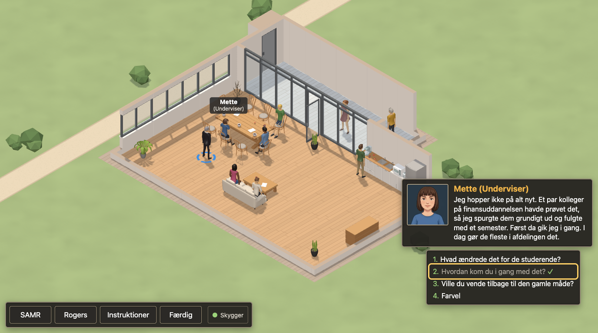
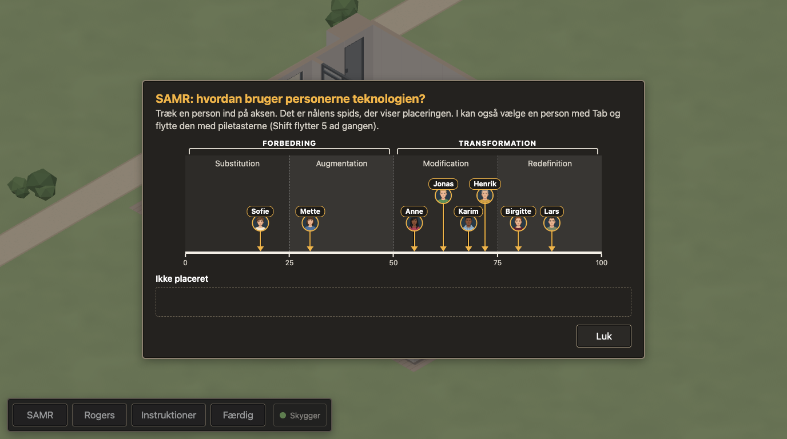

# EduTechReady: the teachers' lounge

*This tool is developed with support from AI, but it has been evaluated by a human before upload.*

A small browser game for teacher training workshops. Pairs of educators walk around an isometric 3D teachers' lounge, talk to eight colleagues about how they use technology in their teaching, and place each colleague on the SAMR model and on Rogers' diffusion-of-innovations curve. With a session link, the placements are collected anonymously, and every pair (and a projector page) then sees how all pairs in the session placed each character.

All text in the game is Danish. It runs in current Chrome, Edge, Firefox and Safari on laptops and desktops with WebGL 2. There are no accounts, cookies or analytics; collected data is anonymous and is deleted once it is older than 30 days: automatically on the next submission while collection is on, or by hand after the workshop (see [DEPLOY.md](docs/DEPLOY.md), "Switching collection off").

- `index.html`: the game. Without `?session=CODE` it runs in practice mode and sends nothing.
- `facilitator.html`: makes a session code and shows the links for the pairs and the projector.
- `results.html?session=CODE`: the projector and print view.

Live demo: <https://experiments.davidlindholm.info/edutechready/>



## Running a workshop session

1. Open `facilitator.html` (on the live site: <https://experiments.davidlindholm.info/edutechready/facilitator.html>). It makes a random six-character session code.
2. Share the participant link (`index.html?session=CODE`) with the pairs, for example in the course chat or as a short link on a slide. Use the copy buttons.
3. Open the projector link (`results.html?session=CODE`) on the projector. It refreshes every 30 seconds and "Gem som PDF" prints it.
4. Each pair talks to the characters, places them under SAMR and Rogers in the menu, and presses Færdig. After sending, the pair sees everyone's placements, with its own marked.



A code needs no setup on the server: the first submission with a new code starts the session.

## Running it locally

You need Node.js 24 or newer and PHP 8.3 or newer with the SQLite PDO driver (`pdo_sqlite`). The end-to-end tests also need Playwright's Chromium (see Tests). three.js and the converted 3D models are committed, so Blender and the source asset packs are only needed to convert new models (`docs/ASSETS.md`).

```sh
npm install
cp private/config.example.php private/config.php
```

In `private/config.php`, switch to the SQLite lines (the commented-out `dsn`, `user` and `password`). The tables are created in `db/dev.sqlite` on the first request.

```sh
npm run serve
```

This runs PHP's built-in server on <http://127.0.0.1:8080> with `public/` as the web root. Open <http://127.0.0.1:8080/index.html> (practice mode), or make a code at <http://127.0.0.1:8080/facilitator.html>. Add `debug=1` to the game's address for an FPS counter, the walkable-grid overlay (key G) and all nameplates (key L).

The built-in server holds each request body in memory, so do not send it very large request bodies.

## Tests

```sh
npm test                 # unit tests (node --test), pure logic in public/js/lib/
npm run validate         # content files: schemas, cross-references, placeholder count
npx playwright install chromium   # once
npx playwright test      # end-to-end tests in Chromium (starts npm run serve if it is not running)
scripts/test_api.sh      # API tests with curl, against npm run serve
```

- `scripts/test_api.sh` temporarily replaces `private/config.php` with a throwaway SQLite database while it runs. Do not run it at the same time as the Playwright tests.
- The Playwright tests render with SwiftShader (software WebGL), so they are slow; they run one at a time. Any console error fails a test. Screenshots go to `docs/screenshots/`.

### Testing the upload package

`scripts/package.sh` builds `dist/lounge-<date>.zip` (see `docs/DEPLOY.md` for its layout). To run the full end-to-end suite against the unzipped package:

```sh
REPO=$PWD                     # the repository folder
ZIP=$(scripts/package.sh)     # prints the path of the zip it built
mkdir -p /tmp/lounge-pkg && cd /tmp/lounge-pkg && unzip -o "$ZIP"
cat > edutechready/private/config.php <<'EOF'
<?php
return [
    'dsn' => 'sqlite:' . dirname(__DIR__) . '/db/package-test.sqlite',
    'user' => null, 'password' => null,
    'api_enabled' => true, 'retention_days' => 30,
    'max_submissions_per_session' => 200, 'max_body_bytes' => 16384,
];
EOF
php -S 127.0.0.1:8081 -t edutechready &          # stop it afterwards with: kill %1
cd "$REPO" && E2E_BASE_URL=http://127.0.0.1:8081 npx playwright test
```

`E2E_BASE_URL` points the suite at another server (default `http://127.0.0.1:8080`); Playwright then does not start `npm run serve`. The asset viewer test is skipped there, because the developer pages in `public/dev/` are not part of the package. The suite overwrites the screenshots in `docs/screenshots/` (a git-ignored folder).

## Editing the content

Characters, their dialogue and summaries, portraits, the map, furniture, the instructions window and every UI text live in JSON files under `public/content/`. See [docs/CONTENT.md](docs/CONTENT.md) for how to edit them, and run `npm run validate` afterwards.

## Deploying

See [docs/DEPLOY.md](docs/DEPLOY.md): building the zip, the database, the settings file, the upload, a smoke test with curl, and switching collection off after a workshop.

## Project layout

```
public/          the web root: pages, css/, js/ (lib/ pure logic, render/ three.js, ui/ overlays),
                 vendor/three/, assets/, content/, api/ (PHP), dev/ (developer pages, not deployed)
private/         config.example.php (config.php holds the real settings and is never committed)
db/              database schemas (MySQL for the server, SQLite for development)
scripts/         packaging, content validation, asset conversion, API tests
tests/           unit/ (node --test) and e2e/ (Playwright)
translations/en/ English versions of characters.json and instructions.json (see English version)
docs/            CONTENT.md, DEPLOY.md, ASSETS.md, TRANSLATING.md, images/ (README screenshots)
LICENSE          the GNU AGPL 3.0 licence text
```

## English version

The interface is in Danish only. English translations of the characters' dialogue and of the instructions window are in `translations/en/` (`characters.json` and `instructions.json`). They are drop-in replacements for the files of the same name in `public/content/`, with the same ids and structure, so copying them over gives English characters and instructions in an otherwise Danish game. The English instructions name the buttons Done, Goodbye and Instructions, which the Danish interface calls Færdig, Farvel and Instruktioner; translate those three texts in `ui.json` too (`menu.finish`, `dialogue.farewell`, `menu.instructions`), or keep the Danish button names in the English instructions. A full English version also needs `public/content/ui.json` and a few other places translated; [docs/TRANSLATING.md](docs/TRANSLATING.md) lists them.

## Licences

Different parts of the project have different licences:

| Part | What it covers | Licence |
|---|---|---|
| Code | All source code: `public/js/`, `public/api/`, the HTML pages, the CSS, the `.htaccess` files, `scripts/`, `tests/`, `db/` and `private/config.example.php`. The map and configuration data (`public/content/level.json`, `public/content/assets.json` and the JSON schemas in `public/content/schema/`) count as code. | [GNU AGPL-3.0-or-later](LICENSE), Copyright (C) 2026 David Lindholm. Full text in `LICENSE`. |
| Content | The Danish and English texts in `public/content/characters.json`, `public/content/instructions.json`, `public/content/ui.json` and `translations/en/`, and the portraits in `public/assets/portraits/`. The portraits were generated with Google Gemini from a prompt by David Lindholm and are offered under this licence to the extent copyright applies to them. | [Creative Commons Attribution 4.0 International (CC BY 4.0)](https://creativecommons.org/licenses/by/4.0/), (C) 2026 David Lindholm. |
| Documentation | `README.md`, the guides in `docs/` and the screenshots in `docs/images/` (the screenshots show the CC0 models and the CC BY portraits, which keep their own licences). | CC BY 4.0, (C) 2026 David Lindholm. |
| 3D models | The models in `public/assets/models/`, by their creators (see Credits). `papers.glb` is generated by `scripts/make_papers.mjs`. | CC0 1.0 (public domain) |
| three.js | `public/vendor/three/` | MIT, (C) three.js authors, `public/vendor/three/LICENSE` |

The upload package built by `scripts/package.sh` includes `LICENSE` and this README, so the licences travel with every copy.

In practice: you may use, change and share the code. If you run a changed version on a server that other people use, the AGPL asks you to offer them its source code. The texts and portraits may be reused and adapted for any purpose, as long as you credit them, for example "Texts and portraits: David Lindholm, CC BY 4.0". The 3D models are not relicensed: they stay CC0 1.0 as published by their creators.

## Credits

3D models (all CC0 1.0, public domain; details per model in `docs/ASSETS.md` and `public/content/assets.json`):

| Pack | Author | Used for | Licence |
|---|---|---|---|
| Animated Women Pack | [Quaternius](https://quaternius.com) | the four women | CC0 1.0 |
| Animated Men Pack | [Quaternius](https://quaternius.com) | the men and the player | CC0 1.0 |
| Ultimate Furniture Pack | [Quaternius](https://quaternius.com) | table, chairs, sofa | CC0 1.0 |
| Furniture Pack | [Quaternius](https://quaternius.com) | coffee table | CC0 1.0 |
| Ultimate House Interior Pack | [Quaternius](https://quaternius.com) | kitchen counter, fridge, drawer cabinet, plants | CC0 1.0 |
| Furniture Kit 2.0 | [Kenney](https://kenney.nl) | coffee machine, microwave, toaster | CC0 1.0 |
| Food Kit | [Kenney](https://kenney.nl) | cups, mug, apple, croissant, muffin | CC0 1.0 |

Thank you to Quaternius and Kenney for making these freely available. The papers on the table are generated by `scripts/make_papers.mjs` (CC0 1.0).

Software: [three.js](https://threejs.org) 0.186.1, MIT licence (`public/vendor/three/LICENSE`).
